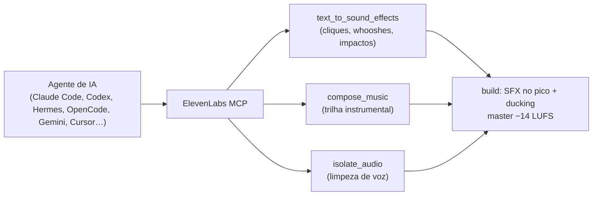

# 🎬 Neuro MV Edit — Sistema Audiovisual & Motion Graphics (v1.10.0)

[](https://github.com/monrars1995/oneuros-mv-edit/releases)
[](LICENSE)
[](https://elevenlabs.io/docs/eleven-api/resources/mcp-server)
[](https://github.com/heygen-com/hyperframes)
[-61dafb.svg)](https://www.remotion.dev)
[](#plataformas-e-zonas-seguras)

> **Pós-produção e motion graphics de alta retenção, feitos por agentes de IA.** Você entrega o vídeo bruto e o perfil do apresentador, e o neuro-mv-edit cuida do resto: decupagem, cortes, legendas pt-BR, cenas animadas, câmera, sound design com o ElevenLabs, master de loudness, metadados no MP4, copy de postagem e arquivamento da entrega.
>
> - **Dois motores à escolha:** Remotion (padrão), com o Studio aberto no navegador e o projeto sempre salvo, e HyperFrames. Os dois podem ser combinados por cena.
> - **Formatos e redes:** Reels, TikTok, Shorts, YouTube 16:9 e Feed.
> - **Segmentos:** jurídico, automotivo, educação, saúde e vendas.

**Sumário:**
- **Primeiros passos:** [Início rápido](#início-rápido) · [Instalação](#instalação)
- **Uso:** [Claude Code](#usando-no-claude-code) · [Outros agentes](#usando-em-outros-agentes) · [O que acontece numa edição](#o-que-acontece-numa-edição)
- **Recursos:** [Motores](#motores-de-edição) · [Biblioteca](#biblioteca-perfis-temas-e-estilos) · [Comandos](#referência-rápida-de-comandos) · [ElevenLabs](#elevenlabs-sound-design) · [Plataformas](#plataformas-e-zonas-seguras) · [Compliance](#compliance-por-segmento)
- **Manutenção:** [Atualização](#atualização) · [Desinstalação](#desinstalação) · [Problemas](#solução-de-problemas) · [Estrutura](#estrutura-do-repositório) · [Releases](#desenvolvimento-e-releases) · [Privacidade](#-privacidade)

Todos os comandos e opções, um por um, estão em **[docs/COMANDOS.md](docs/COMANDOS.md)**.

---

## Início rápido

**1. Instale:**

```bash
npx --yes github:monrars1995/oneuros-mv-edit#v1.10.0
```

O assistente:
- detecta os agentes da máquina e pergunta em quais instalar;
- instala o motor e as fontes;
- oferece criar o primeiro perfil.

**2. No Claude Code**, abra uma sessão nova e rode:

```text
/neuro-mv-edit:setup
/neuro-mv-edit:perfil novo
/neuro-mv-edit:editar videos/IMG_1266.MOV exemplo_juridico
```

- **`setup`** confere o ambiente e lembra de autorizar o ElevenLabs em `/mcp`.
- **`perfil novo`** cria o perfil do cliente com perguntas no chat. Pule este passo se o perfil já existe.
- **`editar`** faz o vídeo inteiro e para três vezes para você aprovar: os cortes, as cenas e a revisão final.

**3. Em outro agente** (Codex, Hermes, OpenCode, Open Design, Neuro Harness, Gemini, Cursor), peça em linguagem natural: veja [Usando em outros agentes](#usando-em-outros-agentes).

---

## Instalação

### Requisitos

| Requisito | Versão | Para quê | Como instalar |
|---|---|---|---|
| Git | — | O `npx` clona o repositório público pelo git (o pacote não está no npm) | `brew install git`. Teste: `git ls-remote https://github.com/monrars1995/oneuros-mv-edit` |
| **Node.js** | 22+ | O CLI e os motores HyperFrames e Remotion | `brew install node` ou `nvm install 22` |
| **Python** | 3.10+ | Os scripts de projeto, cortes, legendas, master, metadados e entrega | `brew install python` |
| **FFmpeg** | 5+ | Mezanino, `silencedetect`, fala do EDL, ducking por sidechain, master de loudness | `brew install ffmpeg` |
| **git** | qualquer | Os checkpoints de cada projeto e o `npx github:` | vem com as Xcode Command Line Tools |
| **Google Chrome** | atual | O render do HyperFrames. O Remotion baixa o próprio Chrome Headless Shell | chrome.com |
| Motor Remotion | 4.0.539 (fixo) | Edição no Studio, instalada uma vez em `~/.neuro-mv-edit/remotion/4.0.539/` (~250 MB) | sozinho no 1º projeto, ou `remotion setup` |
| uv / uvx *(opcional)* | 0.4+ | Só para o servidor ElevenLabs **local** | `curl -LsSf https://astral.sh/uv/install.sh \| sh` |

O `verificar --corrigir` confere tudo isso pelas decisões da edição (resolução, codec, motor) e instala o que faltar, inclusive as fontes (veja [Fontes](#fontes)).

### Instalar

| Situação | Comando |
|---|---|
| Pessoa no terminal: o assistente pergunta | `npx --yes github:monrars1995/oneuros-mv-edit#v1.10.0` |
| Agente de IA, CI ou script: sem perguntas | `npx --yes github:monrars1995/oneuros-mv-edit#v1.10.0 install` |
| O assistente com as respostas padrão | `npx --yes github:monrars1995/oneuros-mv-edit#v1.10.0 setup --yes` |
| Simular sem escrever nada | `... install --dry-run` |
| Só alguns agentes | `... install --agent claude-code,codex` |
| Só o Neuro Harness (plugin no perfil `neuro`) | `... install --agent neuro-harness` |
| Um agente como skill em vez de plugin | `... install --mode claude-code=skill` |

Fixe sempre a tag (`#vX.Y.Z`): o `npx` guarda em cache o que já baixou. A lista de opções está em [docs/COMANDOS.md](docs/COMANDOS.md#instalação-e-diagnóstico).

### Onde cada agente recebe o neuro-mv-edit

O padrão é **plugin** em todo agente que tem sistema de plugin. Os outros recebem a pasta da skill.

| Agente | Id (`--agent`) | Padrão | Onde | Verificação |
|---|---|---|---|---|
| **Claude Code** | `claude-code` | plugin (fixo na tag) | plugin `neuro-mv-edit@neuro-mv-edit`, escopo do usuário | `claude plugin details neuro-mv-edit@neuro-mv-edit` |
| **Codex** | `codex` | skill | `~/.agents/skills/neuro-mv-edit` | `codex debug prompt-input` |
| **OpenCode** | `opencode` | plugin V2 | `~/.config/opencode/plugins/neuro-mv-edit` | `status --deep` |
| **Hermes Agent** | `hermes` | plugin (fixo no commit da tag) | plugin `neuro-mv-edit` | `hermes plugins list` |
| **Open Design** | `open-design` | sempre plugin | biblioteca do Open Design (o app aberto) | `od plugin info neuro-mv-edit` |
| **Neuro Harness** (DeepSeek Harness) | `neuro-harness` | plugin (fixo na tag; de um clone, `link:`) | plugin `neuro-mv-edit` no perfil `neuro` (`~/.neuro-harness/dsh/profiles/neuro`) | `status --deep` |
| Gemini CLI | `gemini-cli` | skill | `~/.gemini/skills` | — |
| Antigravity, Antigravity CLI | `antigravity`, `antigravity-cli` | skill | `~/.gemini/antigravity/skills`, `~/.gemini/antigravity-cli/skills` | — |
| Cursor | `cursor` | skill | `~/.cursor/skills` | — |
| Kimi, Warp, Zed, Pi e outros | `universal` | skill | `~/.agents/skills/neuro-mv-edit` | — |

- **Trocar de modo:**
  - **para plugin:** sai a cópia avulsa da skill daquele agente;
  - **para skill:** o plugin dele é desinstalado.

  Assim a skill nunca carrega duas vezes.
- **`--skills-only`** vale para o Claude Code, o Hermes, o OpenCode e o Neuro Harness. O Open Design é sempre plugin.
- **Codex com muitas skills:** o Codex mostra ao modelo só parte da lista. A skill continua carregada: chame com `$neuro-mv-edit`.
- **Hermes:** a skill do plugin ganha um namespace (`agent-plugin-neuro-mv-edit-<hash>:neuro-mv-edit`). O aviso "Skipped Node deps" é inofensivo.
- **Open Design:**
  - o app precisa estar aberto;
  - o instalador usa a pasta local, e o plugin entra como confiável;
  - se o plugin vier do GitHub (só com o repositório público), conceda as capacidades: `od plugin trust neuro-mv-edit --capabilities bash,network,fs:read,fs:write`.
- **Neuro Harness:**
  - é detectado pelo perfil `~/.neuro-harness/dsh/profiles/neuro` (ou `~/.neuro-mv-superagent/…`, o nome antigo). Outra pasta ou outro perfil: `NEURO_HARNESS_HOME` e `NEURO_HARNESS_PROFILE`;
  - o instalador roda `dsh plugin --profile neuro add <origem>` com o `dsh` do runtime do Harness e `DSH_HOME=<pasta>/dsh`. A origem é a tag no GitHub (`github:monrars1995/oneuros-mv-edit#vX.Y.Z`) ou, de um clone, `link:<clone>`;
  - o plugin registra a skill e põe o comando `neuro-mv-edit` no PATH das sessões. Depois de instalar, reinicie o Harness (`neuro-harness restart`);
  - em modo skill, o Harness lê `~/.agents/skills`, a mesma cópia do Codex. Por isso o instalador nunca apaga essa pasta pelo `neuro-harness`;
  - uma cópia em `~/.agents/skills` ou em `~/.neuro-harness/dsh/skills` tem precedência sobre a skill do plugin no Harness. O `status --deep` avisa quando a versão dela é outra.

### Conferir

```bash
npx --yes github:monrars1995/oneuros-mv-edit#v1.10.0 status --deep
```

O `status --deep` mostra, por agente, onde o neuro-mv-edit está, a versão e o modo. Ele também pergunta ao próprio agente se carrega a skill: Claude Code (skills, comandos, subagentes e MCP do plugin), Codex, Hermes, Open Design e Neuro Harness (versão do `dsh`, origem do plugin e se está ativo no perfil).

Depois de instalar ou atualizar, **abra uma sessão nova** de cada agente.

### Instalação manual dos plugins

Se preferir instalar sem o instalador:

| Plataforma | Comando |
|---|---|
| Claude Code | `claude plugin marketplace add monrars1995/oneuros-mv-edit#v1.10.0` e `claude plugin install neuro-mv-edit@neuro-mv-edit --scope user` |
| Hermes | `hermes plugins install monrars1995/oneuros-mv-edit --enable --yes-deps --ref <SHA do commit da tag>` |
| Open Design | `od plugin install <clone>/skills/neuro-mv-edit` (pasta local, entra como confiável) |
| OpenCode | copie `plugins/opencode/` para `~/.config/opencode/plugins/neuro-mv-edit/`, com a skill em `skill/` |
| Neuro Harness | `DSH_HOME=~/.neuro-harness/dsh ~/.neuro-harness/runtime/node_modules/.bin/dsh plugin --profile neuro add github:monrars1995/oneuros-mv-edit#v1.10.0` (de um clone: `add link:<clone>`) e `neuro-harness restart` |
| Qualquer agente (skills CLI) | `npx skills add monrars1995/oneuros-mv-edit -g -a claude-code -a codex -a opencode -a hermes-agent` |

O SHA da tag sai de `git ls-remote https://github.com/monrars1995/oneuros-mv-edit 'refs/tags/vX.Y.Z^{}'` (troque `X.Y.Z` pela versão).

---

## Usando no Claude Code

O plugin traz:
- a skill;
- 9 comandos;
- 2 subagentes;
- um hook de início de sessão (lembra as decisões de exportação e o estado da última verificação);
- o servidor MCP do ElevenLabs;
- o comando `neuro-mv-edit` no PATH.

Ele funciona no Claude Code do terminal, na aba Code do app desktop e no VS Code. Não instala no claude.ai nem no Cowork, que não aceitam plugins com executáveis e não têm ffmpeg nem Remotion locais.

### Comandos

| Comando | Argumentos | O que faz | Exemplo |
|---|---|---|---|
| `/neuro-mv-edit:editar` | `<vídeo> [perfil] [--engine remotion\|hyperframes] [--estilo <id>] [--resolucao 4k,1080p] [--codec h264\|hevc\|prores]` | Pergunta resolução, codec e fps, verifica o ambiente e edita do bruto à entrega, parando para aprovação (abaixo) | `/neuro-mv-edit:editar videos/aula.mp4 exemplo_educacao --resolucao 4k,1080p` |
| `/neuro-mv-edit:exportar` | `[pasta do projeto] [--resolucao ...] [--codec ...] [--qualidade alta\|maxima]` | Exporta de novo em outras resoluções e codecs, sem perder qualidade | `/neuro-mv-edit:exportar projetos/cpr --resolucao 4k --codec prores` |
| `/neuro-mv-edit:verificar` | `[--motor ...] [--resolucao ...] [--codec ...] [--video <fonte>]` | Verifica e instala dependências, skills de apoio e MCPs para a edição pedida | `/neuro-mv-edit:verificar --resolucao 4k --codec hevc` |
| `/neuro-mv-edit:perfil` | `[novo \| editar <id> \| listar \| mostrar <id>]` | Cria ou edita um perfil com perguntas no chat, e mostra a prévia | `/neuro-mv-edit:perfil editar exemplo_juridico` |
| `/neuro-mv-edit:tema` | `[listar \| preview <id> \| novo \| editar <id>]` | Mostra os temas, gera a prévia HTML ou cria um tema | `/neuro-mv-edit:tema preview noticia_impacto` |
| `/neuro-mv-edit:estudio` | `[pasta do projeto] [parar]` | Abre o Remotion Studio (ou o preview do HyperFrames) e mostra a URL | `/neuro-mv-edit:estudio projetos/cpr` |
| `/neuro-mv-edit:entregar` | `[pasta do projeto] [rede]` | Metadados e copy no último master, e arquivamento em `entregas/` | `/neuro-mv-edit:entregar projetos/cpr reels` |
| `/neuro-mv-edit:setup` | — | Confere ffmpeg, Node, motores, fontes e ElevenLabs, e resolve o que faltar | `/neuro-mv-edit:setup` |
| `/neuro-mv-edit:status` | `[pasta do projeto]` | Estado do projeto: motor, cortes, cenas, Studio, checkpoints, último render | `/neuro-mv-edit:status projetos/cpr` |

- **A skill sozinha:** `/neuro-mv-edit:neuro-mv-edit`. Ela também é ativada sozinha quando o pedido é de edição de vídeo.
- **Sem pasta nos argumentos:** os comandos de projeto usam a pasta atual (se tiver `neuro.json`) ou o projeto mais recente em `projetos/`.

> **Dois nomes iguais, duas coisas diferentes.**
> - `/neuro-mv-edit:status` mostra um projeto. `neuro-mv-edit status` mostra a instalação nos agentes.
> - `/neuro-mv-edit:setup` confere o ambiente. `neuro-mv-edit setup` é o instalador dos agentes, rodado no terminal.

### Como o `/neuro-mv-edit:editar` trabalha

1. **Perfil e motor.**
   - Sem perfil nos argumentos, ele lista os perfis e pergunta qual usar.
   - O motor é o do perfil; se o perfil não define, Remotion.
2. **Projeto.** Mede o topo da cabeça num quadro do vídeo e cria o projeto em `projetos/<nome>`.
3. **Transcrição e legendas.** Mostra os termos suspeitos e corrige com o glossário do perfil. As correções que você pedir para valer nos próximos vídeos vão para a memória.
4. **Decupagem.**
   - Calcula os cortes de silêncio e pede ao `decupador` as tomadas repetidas e as claquetes.
   - **Para você aprovar os cortes.**
5. **Cenas.**
   - Escreve o `cues.json` e gera o projeto.
   - Abre o Studio e mostra a URL.
   - Roda `check` e `snapshot` e confere os PNGs.
   - **Para você aprovar as cenas.** Ajuste no Studio ou peça no chat.
6. **Som.**
   - Gera os efeitos que faltam com o ElevenLabs e, se o perfil pede, a trilha.
   - Abaixa a trilha sob a fala.
7. **Render, master e revisão.**
   - Renderiza e faz o master de loudness.
   - Pede ao `revisor` o checklist de entrega.
   - **Para você aprovar a revisão.**
8. **Entrega.** Grava os metadados, a copy e a pasta da entrega (`/neuro-mv-edit:entregar`).

**O projeto está sempre salvo:**
- toda ação faz um checkpoint git local;
- o Studio grava cada edição direto nos arquivos.

Para desfazer: `neuro-mv-edit projeto historico -P projetos/<nome>` e `neuro-mv-edit projeto voltar <ref> -P projetos/<nome>`.

### Subagentes

| Subagente | Quando | Devolve |
|---|---|---|
| `@agent-neuro-mv-edit:decupador` | Antes de aplicar os cortes | Os trechos a tirar, com início e fim em segundos e o motivo, e a linha pronta `neuro-mv-edit projeto cortar -P <proj> --remover a-b … --dry-run` |
| `@agent-neuro-mv-edit:revisor` | Depois do build ou do render | Uma tabela `cena \| tempo \| problema \| correção`, os itens que passaram e o veredito ("pronto para entregar" ou "corrigir antes") |

- Os dois só leem: não alteram o projeto.
- O `/editar` chama os dois sozinho.
- Para chamar à mão: `@agent-neuro-mv-edit:revisor projetos/cpr`.

### O comando `neuro-mv-edit` nas sessões

Enquanto o plugin está ativo, o comando `neuro-mv-edit` fica no PATH das sessões do Claude Code (e do Neuro Harness, com o plugin dele). O agente roda `neuro-mv-edit perfil listar` ou `neuro-mv-edit projeto build -P projetos/cpr` sem `npx` e sem rede.

Fora dessas sessões (num terminal comum ou em outro agente), use `npx --yes github:monrars1995/oneuros-mv-edit#v1.10.0 <comando>`.

### ElevenLabs no plugin

O plugin já traz o servidor `https://api.elevenlabs.io/v1/mcp`. Autorize uma vez: numa sessão, digite `/mcp`, escolha o `elevenlabs` e faça o login no navegador. Não precisa de `claude mcp add`.

Se você já tinha o mesmo endereço configurado, o Claude Code mantém uma conexão só.

### Exemplo de sessão

```text
você  › /neuro-mv-edit:editar gravacoes/cpr_prazo.mov exemplo_juridico
agente› Projeto criado em projetos/cpr_prazo (Remotion, Reels, cabeça em y=560).
        Termos suspeitos no transcript: "exédulas" → "cédulas"? …
agente› Cortes propostos: 14 silêncios (6,2 s) + 2 tomadas repetidas (decupador). Aprova?
você  › aprovo, mas mantenha 40–44 s
agente› Studio aberto em http://localhost:3000 — 7 cenas, PNGs revisados. Aprova as cenas?
você  › troque a cena 3 por um checklist
agente› … revisor: pronto para entregar. Master −14,0 LUFS. Entrega em entregas/2026-11/07/reels/
```

---

## Usando em outros agentes

Peça em linguagem natural. O agente lê a skill e usa o CLI pelo `npx`, porque o comando `neuro-mv-edit` só fica no PATH nos plugins do Claude Code e do Neuro Harness.

| Agente | Como chamar |
|---|---|
| **Codex** | `$neuro-mv-edit` + o pedido (com muitas skills instaladas, o `$` garante que ele ache) |
| **Hermes** | Pedido normal. A skill vem do plugin, com namespace `agent-plugin-neuro-mv-edit-<hash>:neuro-mv-edit` |
| **OpenCode** | Pedido normal. O plugin V2 registra a skill `neuro-mv-edit` |
| **Open Design** | Com o app aberto e o plugin confiável, peça a edição no chat do app |
| **Neuro Harness** | Pedido normal, ou `/neuro-mv-edit` + o pedido no chat. O plugin registra a skill e põe o comando `neuro-mv-edit` no PATH da sessão, então o agente usa o CLI direto, sem `npx` |
| **Gemini CLI, Antigravity, Cursor, Kimi, Warp, Zed** | Pedido normal, ou cite "neuro-mv-edit" para a skill ser carregada |

Exemplos de pedido:

```text
$neuro-mv-edit edite videos/IMG_1266.MOV com o perfil exemplo_juridico para o Reels
```

```text
Use a skill neuro-mv-edit: processe gravacoes/aula.mp4 com o perfil exemplo_educacao no formato TikTok, motor hyperframes
```

```text
Com o neuro-mv-edit, crie um perfil para a Dra. Ana (saúde, @dra.ana), tema clean_paper, estilo educativo_claro
```

O ElevenLabs nesses agentes precisa ser configurado à mão: veja [ElevenLabs](#elevenlabs-sound-design).

---

## O que acontece numa edição

| Etapa | Comando | Resultado |
|---|---|---|
| 0. Decisões e ambiente | `exportacao analisar` + `verificar --corrigir` | Resolução (4K, 1440p, 1080p, original), codec (H.264, HEVC, ProRes) e fps decididos por você; dependências, skills de apoio e MCPs conferidos e instalados |
| 1. Projeto | `projeto init --resolucao ... --codec ...` | Mezanino CFR na resolução útil da fonte, tema, layout pelo topo da cabeça e `neuro.json` |
| 2. Transcrição | `projeto transcrever` | `assets/transcript.json`, palavra a palavra (Whisper, pt) |
| 3. Legendas | `projeto legendas --apply-glossary` | Transcript corrigido pelo glossário e pela sua memória; legendas do perfil e SRT |
| 4. Decupagem | `projeto cortar` | `edl.json`: silêncios confirmados por `silencedetect`, respiros, claquetes e as tomadas que você tirou com `--remover` |
| 5. Cenas | `cues.json` + `projeto build` | Cartões, câmera, SFX, trilha, efeitos e B-roll, nas camadas do motor |
| 6. Acompanhamento | `projeto estudio` | Studio no navegador. O que você muda lá volta para o projeto, com checkpoint |
| 7. QA | `projeto check` + `projeto snapshot` | Avisos de zona segura, legenda e SFX, e um PNG por cena |
| 8. Render e master | `projeto render` + `projeto master` | Uma versão nativa por resolução (PNG por quadro, uma codificação só, `bt709`): `renders/master/<NOME>_MASTER.mp4` (EBU R128, −14 LUFS; vídeo copiado sem recompressão), `_MASTER_1080p.mp4` etc., `_MASTER_leve.mp4` e `<NOME>_loudness.json` |
| 9. Metadados e copy | `metadata` | `<vídeo>_meta.mp4` com as tags `title`, `artist`, `album_artist`, `comment`, `description`, `copyright`, `genre` e `date`, mais o `<vídeo>_meta_COPY_POSTAGEM.md` |
| 10. Entrega | `organize` | **Cópia** para `entregas/AAAA-MM/DD/<rede>/`: o vídeo, a cópia leve, o relatório e a copy |
| 11. Aprendizado | — | O que você pedir para valer nos próximos vídeos vai para `~/.neuro-mv-edit/memory.json` |

---

## Exportação em 4K sem perder qualidade

Você decide antes da edição, e a decisão vale do mezanino ao master:

| Opção | Valores | Padrão |
|---|---|---|
| Resolução | `4k` (2160 no lado curto), `1440p`, `1080p`, `720p`, `original` (a da fonte); várias de uma vez | `1080p` |
| Codec | `h264` (todas as redes), `hevc` (H.265, ~40% menor, marcado `hvc1`), `prores` (422 HQ, `.mov`, master para arquivo) | `h264` |
| FPS | `original` (o da fonte), `24`, `25`, `30`, `50`, `60` | `original` |
| Qualidade | `alta` (CRF do perfil, 17) ou `maxima` (CRF 12 no H.264, 14 no HEVC) | `alta` |

```bash
neuro-mv-edit exportacao analisar bruto.mov --plataforma instagram_reels   # o que a fonte rende e a recomendação
neuro-mv-edit projeto init -p exemplo_educacao -v bruto.mov -o projetos/aula --resolucao 4k,1080p --codec h264
neuro-mv-edit projeto render -P projetos/aula        # uma versão nativa por resolução
neuro-mv-edit projeto master -P projetos/aula --name AULA
```

O que garante a qualidade:
- **Supersampling, não ampliação.** A composição fica nas coordenadas do layout (zonas seguras e legendas iguais) e o render desenha cada quadro direto na resolução final: texto e gráficos são vetor e saem nítidos em 4K.
- **O vídeo da fonte não é reduzido antes da hora.** O mezanino guarda a área útil da fonte até a maior saída; quando precisa recodificar (HEVC/ProRes/10-bit do celular, fps, grade do perfil, HDR), usa H.264 CRF 10, visualmente sem perda.
- **Uma codificação só.** PNG por quadro no render e o codec escolhido no fim, com `bt709` marcado. O master só ajusta o áudio; o vídeo é copiado.
- **Sem promessa falsa:** um 4K horizontal rende só 1215x2160 num Reels 9:16. O `analisar` e o `init` avisam quando uma resolução amplia o vídeo e recomendam a maior que não amplia.

---

## Motores de edição

Cada projeto escolhe o motor no `init`:
1. a opção `--engine remotion|hyperframes`;
2. senão, a variável `NEURO_ENGINE`;
3. senão, o `engine_default` do perfil;
4. senão, `remotion`.

Os dois usam os mesmos comandos (`projeto …`) e os mesmos 7 templates de cena.

| | **Remotion** (padrão) | **HyperFrames** |
|---|---|---|
| Edição | Cortes, câmera, cartões, SFX, trilha, efeitos e B-roll como camadas editáveis no **Remotion Studio** | Cenas HTML ajustáveis no preview |
| Interface web | `projeto estudio` abre o Studio e liga o vigia, que sincroniza e faz checkpoint | `projeto estudio` abre o `hyperframes preview` |
| Cortes | Clipes não destrutivos (arraste a borda no Studio) | O ffmpeg monta `assets/base_cortado.mp4` |
| QA | `check` (avisos + bundle) e `snapshot` (PNG por cena) | `check` (layout, contraste, faixa de legenda) e `snapshot` (modo review) |
| Licença | Grátis até 3 pessoas; **Company License a partir de 4** | Apache-2.0 |

- **Os dois juntos:** no Remotion, uma cena com `"motor": "hyperframes"` é renderizada pelo HyperFrames com alfa (ProRes 4444) e entra na timeline. Só o render final comprime em H.264.
- **O papel do ffmpeg:**
  - o mezanino (CFR, keyframes e grade de cor);
  - a fala montada a partir do EDL, com fades nas emendas;
  - o ducking da trilha por sidechain;
  - o master de loudness em 2 passagens.
- **O build preserva o Studio:** ele nunca sobrescreve uma edição feita no Studio que não sabe representar. Use `--force` para regerar mesmo assim.

| Recurso | O que faz |
|---|---|
| Tokens de marca | Tema, perfil e plataforma viram `assets/neuro-theme.css`, com as fontes oficiais |
| 7 templates de cena | `hook`, `stat`, `quote`, `contrast`, `checklist`, `timeline`, `cta`, na faixa acima da cabeça |
| Câmera | `punch_in`, `cut`, `zoom`, `shift`, `reset`, `shake`, com origem no topo da cabeça |
| Decupagem | `cortar --preset natural\|tight`, `--remover`/`--manter` para a decupagem narrativa |
| SFX e trilha | Pico 1 quadro depois da imagem, takes alternados, trilha abaixada sob a fala |
| Legendas pt-BR | Glossário, correções aprendidas, sem palavra órfã, `pop` ou `karaoke`, SRT sempre |
| Formatos | 9:16 (acima da cabeça), 4:5 e 16:9 (`--layout split_lateral` ou `lower_third`) |

**Licença do Remotion**
- **Grátis:** pessoa física, empresas com até 3 pessoas e ONGs.
- **A partir de 4 pessoas** (contando todo o pessoal): é preciso a [Company License](https://www.remotion.dev/license).
- **Render feito por agente** conta como automação.
- **Chave:** com `REMOTION_LICENSE_KEY` no ambiente, os renders usam a chave.
- **Sem licença:** use `--engine hyperframes`.

Mais detalhes:
- [`remotion/BRIDGE.md`](skills/neuro-mv-edit/references/remotion/BRIDGE.md): o motor Remotion, o Studio e a sincronização.
- [`hyperframes/BRIDGE.md`](skills/neuro-mv-edit/references/hyperframes/BRIDGE.md): o fluxo e o `cues.json`.
- [`TECNICAS.md`](skills/neuro-mv-edit/references/hyperframes/TECNICAS.md): o padrão de acabamento.
- [`CENAS.md`](skills/neuro-mv-edit/references/hyperframes/CENAS.md): as 25 funções de fala e o template de cada uma.

---

## Biblioteca: perfis, temas e estilos

Um **perfil** define o apresentador:
- o tema, o estilo de edição e a plataforma;
- o motor;
- a legenda;
- o tom e o CTA;
- os metadados;
- as regras do setor.

Um **tema** define cores e fontes dos cartões. Um **estilo** define o ritmo: cortes, legenda, câmera e volume dos SFX e da trilha.

**Onde ficam os seus**
- Em `~/.neuro-mv-edit/{perfis,temas,estilos}/`.
- Eles sobrevivem às atualizações.
- Um item seu com o mesmo id de um preset passa a valer no lugar dele.

### Perfis que vêm com a skill

| Id | Apresentador | Segmento | Regras | Tema | Particularidades |
|---|---|---|---|---|---|
| `exemplo_juridico` | Dra. Ana Exemplo (fictícia) | Jurídico tributário | OAB | `editorial_noir` | Legenda Cal Sans branca com destaque dourado; estilo `editorial_sobrio`; master + cópia `_leve`; legenda-modelo da copy |
| `exemplo_educacao` | Escola Exemplo (fictícia) | Educação escolar e bilíngue | ECA + LGPD | `educacao_vibrante` | Enquadramento em dupla (responsável e aluno); estilo `educativo_claro`; sem @ na tela |
| `template_novo_perfil` | — | geral | geral | `noticia_impacto` | Base em branco do `perfil novo` |

Os dois primeiros são exemplos para testar a skill. Perfis reais (de clientes ou da sua equipe) ficam na sua biblioteca: crie com `perfil novo` ou traga um pacote com `perfil importar <pacote.json>`. No Neuro Harness, o pacote privado da equipe é instalado depois do login.

Para ver um perfil inteiro: `neuro-mv-edit perfil mostrar <id>`.

### Temas e estilos

- **8 temas prontos:** `noticia_impacto`, `editorial_noir`, `clean_paper`, `tech_neon`, `corporativo_azul`, `educacao_vibrante`, `luxo_minimal`, `agro_terra`.
- **Temas de marca:** ficam na sua biblioteca (`tema novo`, ou vêm junto num `perfil importar`).
- **5 estilos:** `dinamico_reels`, `editorial_sobrio`, `educativo_claro`, `comercial_acelerado`, `documental_calmo`.

### Criar e editar

| Tarefa | No Claude Code | No terminal |
|---|---|---|
| Ver tudo | — | `neuro-mv-edit info` |
| Perfil novo | `/neuro-mv-edit:perfil novo` | `neuro-mv-edit perfil novo` (assistente) |
| Editar um perfil | `/neuro-mv-edit:perfil editar <id>` | `neuro-mv-edit perfil editar <id>` |
| Prévia de um tema | `/neuro-mv-edit:tema preview <id>` | `neuro-mv-edit tema preview <id> [--perfil <id>]` |
| Tema ou estilo novo | `/neuro-mv-edit:tema novo` | `neuro-mv-edit tema novo` · `neuro-mv-edit estilo novo` |
| Levar para outra máquina | — | `perfil exportar [ids] --saida f.json` · `perfil importar f.json` |

**O que o `perfil novo` pergunta**
- o perfil de partida, o nome e o id;
- o @, o cargo, o segmento e as regras do setor;
- o tema (dá para criar um na hora) e o estilo;
- a plataforma e o motor;
- a legenda: se queima no vídeo, a fonte, as cores e as palavras em destaque;
- o fade final, o tom, o CTA e os metadados.

**Sem terminal (agentes e CI)**
- **Perfis:** passe opções (`--id`, `--nome`, `--tema`…) ou `--json`.
- **Temas e estilos:** só `--json`.

Todas as opções estão em [docs/COMANDOS.md](docs/COMANDOS.md#biblioteca-perfis-temas-e-estilos).

---

## Referência rápida de comandos

Prefixo:
- **na sessão do Claude Code com o plugin:** `neuro-mv-edit`;
- **em outro lugar:** `npx --yes github:monrars1995/oneuros-mv-edit#v1.10.0`;
- **num clone:** `node cli/cli.js`.

| Grupo | Comandos |
|---|---|
| Instalação | `setup` · `install` · `uninstall` · `status [--deep]` · `agents` · `verificar` · `exportacao` · `mcp` · `version` · `help` |
| Biblioteca | `info` · `perfil listar\|mostrar\|novo\|editar\|remover\|exportar\|importar` · `tema listar\|mostrar\|novo\|editar\|remover\|preview` · `estilo listar\|mostrar\|novo\|editar\|remover` |
| Projeto | `projeto init` · `transcrever` · `legendas` · `cortar` · `build` · `estudio` · `sincronizar` · `check` · `snapshot` · `render` · `master` · `salvar` · `historico` · `voltar` · `status` |
| Motor | `remotion setup\|status` · `hf <sub> --project <pasta>` (ponte direta com o HyperFrames) |
| Entrega | `metadata -i <vídeo> -p <perfil> -t "<hook>"` · `organize -m <vídeo> -n <rede>` |

- **`-P <pasta>`:** escolhe o projeto. Sem ele, vale a pasta atual.
- **Opções extras para o motor** vão depois de `--`, ex.: `projeto snapshot -P projetos/cpr -- --at 3.5`.

A referência completa, com cada opção, valor padrão e valores aceitos, está em **[docs/COMANDOS.md](docs/COMANDOS.md)**.

---

## ElevenLabs (sound design)

Nenhum cartão, título ou transição entra mudo. Os efeitos e a trilha vêm do [servidor MCP oficial do ElevenLabs](https://elevenlabs.io/docs/eleven-api/resources/mcp-server).



| Onde | O que fazer |
|---|---|
| **Claude Code com o plugin** | Nada a configurar: autorize uma vez em `/mcp` |
| **Claude Code só com a skill** | `claude mcp add --transport http elevenlabs https://api.elevenlabs.io/v1/mcp` e depois `/mcp` |
| **Outros agentes** | No arquivo de MCP do agente: `{"mcpServers": {"elevenlabs": {"type": "http", "url": "https://api.elevenlabs.io/v1/mcp"}}}` |
| **Local, com chave** (precisa do uv) | `{"mcpServers": {"elevenlabs": {"command": "uvx", "args": ["elevenlabs-mcp"], "env": {"ELEVENLABS_API_KEY": "<sua chave>"}}}}` |

- **Nome do servidor:** use `elevenlabs`. Os modelos prontos estão em [`mcp-config.json`](skills/neuro-mv-edit/mcp-config.json).
- **Guia no terminal:** `neuro-mv-edit mcp`.
- **Sem ElevenLabs:** o `build` avisa que os SFX estão faltando, e a skill sugere a `/media-use` do HyperFrames.

---

## Fontes

O `verificar --corrigir` confere e baixa as fontes oficiais:
- **macOS:** em `~/Library/Fonts`;
- **Linux:** em `~/.local/share/fonts` (ou `$XDG_DATA_HOME/fonts`).

| Fonte | Uso |
|---|---|
| Big Shoulders Display 900 | Títulos condensados e palavras de impacto |
| Fraunces (regular e itálico) | Apoio editorial |
| Inter (variável) | Rótulos, metadados e pílulas |
| Cal Sans SemiBold | Legendas fortes (ex.: `exemplo_juridico`) |
| Instrument Serif (regular e itálico) | Títulos e números editoriais (tema `editorial_noir`) |
| DM Sans (regular, medium, bold) | UI e legendas de educação (ex.: `exemplo_educacao`) |
| Plus Jakarta Sans e Space Grotesk | Títulos contemporâneos e HUD |

```bash
neuro-mv-edit verificar --corrigir
```

---

## Plataformas e zonas seguras

| Plataforma | Id (`--platform`) | Rede (`organize -n`) | Resolução | Margem topo | Margem base | Barra direita | Faixa dos gráficos |
|---|---|---|---|---|---|---|---|
| Instagram Reels | `instagram_reels` | `reels` | 1080×1920 (9:16) | 250 px | 385 px | 193 px (y > 1110) | y 250 até acima da cabeça |
| TikTok | `tiktok` | `tiktok` | 1080×1920 (9:16) | 200 px | 320 px | 170 px (y > 900) | y 200 até acima da cabeça |
| YouTube Shorts | `youtube_shorts` | `shorts` | 1080×1920 (9:16) | 220 px | 340 px | 150 px (y > 1000) | y 220 até acima da cabeça |
| YouTube 16:9 | `youtube_horizontal` | `youtube` | 1920×1080 | 108 px | 108 px | 192 px | Painel lateral ou lower third |
| Feed retrato | `instagram_feed_portrait` | `feed` | 1080×1350 (4:5) | 120 px | 160 px | 60 px | x 60–1020, y 120 até a cabeça |

---

## Compliance por segmento

Cada perfil tem regras do setor (`compliance_framework`). Elas valem:
- na copy de postagem, que ganha a nota de conformidade;
- na decupagem: o `decupador` nunca propõe cortar ressalvas, negativas, números ou nomes de lei;
- na revisão do `revisor`.

| Id | Setor | O que o revisor confere |
|---|---|---|
| `oab_provimento_205_2021` | Advocacia (Provimento OAB 205/2021) | Conteúdo informativo; sem promessa de resultado, sem captação, sem preço; números e teses conferidos |
| `educacao_eca_lgpd` | Educação (ECA + LGPD) | Imagem de menor só com autorização; sem expor dados; linguagem positiva |
| `saude_cfm_publicidade` | Saúde (publicidade médica) | Sem promessa de cura; sem antes e depois |
| `general_creator_retention` | Geral | Só o checklist de qualidade |

---

## Atualização

O caminho normal é rodar o instalador com a tag nova (a da release marcada como **Latest**):

```bash
gh release view --repo monrars1995/oneuros-mv-edit           # qual é a última versão
npx --yes github:monrars1995/oneuros-mv-edit#vX.Y.Z install   # atualiza todos os agentes detectados
npx --yes github:monrars1995/oneuros-mv-edit#vX.Y.Z status --deep
```

**O que a atualização faz**
- **Claude Code:** aponta o marketplace para a tag nova e atualiza o plugin.
- **Hermes:** reinstala o plugin no commit da tag.
- **Neuro Harness:** troca o plugin do perfil pela tag nova (`dsh plugin add`). Reinicie o Harness.
- **Outros agentes:** recria a pasta da skill.
- **O que é seu não muda:** tudo em `~/.neuro-mv-edit/` (perfis, temas, estilos, memória, prévias e o motor Remotion).

Depois, abra uma sessão nova de cada agente.

**À mão, se você instalou os plugins sem o instalador**

| Plataforma | Comando |
|---|---|
| Claude Code | `claude plugin marketplace add monrars1995/oneuros-mv-edit#vX.Y.Z` e depois `claude plugin update neuro-mv-edit@neuro-mv-edit` (ou pela tela `/plugin` numa sessão) |
| Hermes | `hermes plugins install monrars1995/oneuros-mv-edit --enable --yes-deps --force --ref <SHA da tag>` |
| OpenCode | `npx --yes github:monrars1995/oneuros-mv-edit#vX.Y.Z install --agent opencode` |
| Open Design | `npx --yes github:monrars1995/oneuros-mv-edit#vX.Y.Z install --agent open-design` (com o app aberto) |
| Neuro Harness | `DSH_HOME=~/.neuro-harness/dsh ~/.neuro-harness/runtime/node_modules/.bin/dsh plugin --profile neuro add github:monrars1995/oneuros-mv-edit#vX.Y.Z` e `neuro-harness restart` |

> O `claude plugin marketplace update` sozinho **não** muda de versão: o marketplace está fixo numa tag, e o update só baixa a mesma tag de novo.

---

## Desinstalação

```bash
npx --yes github:monrars1995/oneuros-mv-edit#v1.10.0 uninstall --dry-run          # mostra o que sairia
npx --yes github:monrars1995/oneuros-mv-edit#v1.10.0 uninstall                    # todos os agentes
npx --yes github:monrars1995/oneuros-mv-edit#v1.10.0 uninstall --agent hermes     # um agente
npx --yes github:monrars1995/oneuros-mv-edit#v1.10.0 uninstall --target .claude/skills   # instalação feita com --target
```

O `uninstall` remove a skill, os plugins e o marketplace do Claude Code. Ele nunca apaga um clone git nem uma pasta com outra skill de mesmo nome.

**À mão**

| Plataforma | Comando |
|---|---|
| Claude Code | `claude plugin uninstall neuro-mv-edit@neuro-mv-edit` e `claude plugin marketplace remove neuro-mv-edit` |
| Hermes | `hermes plugins remove neuro-mv-edit` |
| Open Design | `od plugin uninstall neuro-mv-edit` |
| OpenCode | apague `~/.config/opencode/plugins/neuro-mv-edit` |
| Neuro Harness | `DSH_HOME=~/.neuro-harness/dsh ~/.neuro-harness/runtime/node_modules/.bin/dsh plugin --profile neuro remove neuro-mv-edit` |

**O que fica**
- A pasta `~/.neuro-mv-edit/` continua: biblioteca, memória, prévias e o motor Remotion (~250 MB).
- Para apagar também, rode `rm -rf ~/.neuro-mv-edit`. Isso não tem volta.

---

## Solução de problemas

| Sintoma | Correção |
|---|---|
| `marketplace 'neuro-mv-edit' … source doesn't match its extraKnownMarketplaces entry` | O `install` da v1.7.1+ resolve sozinho. À mão: `claude plugin marketplace remove neuro-mv-edit`, depois `marketplace add monrars1995/oneuros-mv-edit#vX.Y.Z` e `claude plugin install neuro-mv-edit@neuro-mv-edit --scope user` |
| O `npx` falha com 404 ou pede senha | Confira o endereço (`monrars1995/oneuros-mv-edit`) e a tag. Teste com `git ls-remote https://github.com/monrars1995/oneuros-mv-edit` |
| Os comandos `/neuro-mv-edit:*` não aparecem | Abra uma sessão nova. Confira com `claude plugin details neuro-mv-edit@neuro-mv-edit` e `status --deep` |
| `error: unrecognized arguments: --…` num `projeto` | A opção é do motor, não do neuro-mv-edit: passe-a depois de `--` (`projeto snapshot -P x -- --at 3.5`) |
| `… é interativo e este terminal não é` | Sem terminal, passe opções ou `--json` (ex.: `perfil novo --json p.json`, `setup --yes`) |
| As ferramentas do ElevenLabs não existem na sessão | Autorize em `/mcp`. Fora do plugin, configure o servidor: `neuro-mv-edit mcp` |
| `Node.js v… : HyperFrames exige 22+` | `nvm install 22` ou `brew install node@22` |
| A porta do Studio já está em uso | O Studio procura uma porta livre a partir da 3000. Para escolher uma: `projeto estudio -P x --porta 3100`. Para fechar: `projeto estudio -P x --parar` |
| Um corte caiu no meio da fala | `projeto cortar -P x --manter a-b` protege o trecho, e `--nenhum` desfaz todos os cortes |
| Uma edição do Studio sumiu | `projeto historico -P x` e `projeto voltar <ref> -P x` |

---

## Estrutura do repositório

O repositório segue o layout padrão de plugins: a skill fica em `skills/neuro-mv-edit/`, e cada plataforma tem um manifesto que aponta para ela.

```text
neuro-mv-edit/
├── .claude-plugin/
│   ├── plugin.json                   # Plugin do Claude Code (versão única do plugin)
│   ├── marketplace.json              # Marketplace (claude plugin marketplace add monrars1995/oneuros-mv-edit#vX.Y.Z)
│   └── icon.png                      # Ícone do plugin
├── plugin.json                       # Plugin portátil Agent Plugins v1 (Hermes e outros)
├── plugins/opencode/                 # Plugin OpenCode V2 (server.js + package.json)
├── plugins/dsh/                      # Plugin do DeepSeek/Neuro Harness (index.js + cordis.patch.yml)
├── bin/neuro-mv-edit(.cmd)           # Comando no PATH das sessões do Claude Code e do Neuro Harness (chama cli/cli.js)
├── cli/
│   ├── cli.js                        # Roteador: setup, install, uninstall, status, agents, verify, mcp, info,
│   │                                 #   perfil, tema, estilo, projeto, remotion, hf, metadata, organize, version, help
│   ├── setup.js                      # Assistentes: setup (agentes), perfil, tema, estilo
│   ├── ui.js                         # Perguntas interativas sem dependências
│   ├── library.js                    # Presets da skill + ~/.neuro-mv-edit/{perfis,temas,estilos}
│   ├── agents.js                     # Agentes, caminhos e instaladores de skill e plugin
│   └── version.js                    # Versão única em todos os manifestos
├── commands/                         # /neuro-mv-edit:editar, perfil, tema, estudio, entregar, setup, status
├── agents/                           # Subagentes revisor e decupador
├── .mcp.json                         # ElevenLabs MCP do plugin
├── docs/COMANDOS.md                  # Referência completa de comandos e opções
├── skills/neuro-mv-edit/             # A SKILL (o que cada agente carrega)
│   ├── SKILL.md                      # Manual operacional da IA
│   ├── open-design.json              # Plugin do Open Design
│   ├── mcp-config.json               # Modelos de configuração do ElevenLabs MCP
│   ├── data/memory.json              # Glossários e memória base (só leitura)
│   ├── presets/                      # perfis, temas, estilos, plataformas e animações
│   ├── references/                   # remotion/, remotion-project/, hyperframes/, hyperframes-template/
│   └── scripts/                      # neuro_project.py, neuro_remotion.py, neuro_edl.py, hf_project.py,
│                                     #   neuro_preview.py, inject_metadata.py, organize_deliveries.py, verify-env.py
├── package.json                      # Executável do npx github:monrars1995/oneuros-mv-edit e manifesto `dsh` do plugin do Harness
├── CHANGELOG.md
├── LICENSE
└── README.md
```

---

## Desenvolvimento e releases

**Para testar a partir de um clone:**
- `node cli/cli.js <comando>` roda o CLI do clone.
- `claude --plugin-dir .` abre uma sessão com o plugin do clone, sem instalar nada.
- `claude plugin validate .` confere os manifestos.

O projeto segue o [Versionamento Semântico](https://semver.org/lang/pt-BR/):

| Parte | Quando sobe |
|---|---|
| **MAJOR** | Quebra de compatibilidade (layout, comandos, formato dos perfis ou do `cues.json`) |
| **MINOR** | Recurso novo compatível |
| **PATCH** | Correção |

O histórico está no [`CHANGELOG.md`](CHANGELOG.md). Cada versão tem uma tag `vX.Y.Z` e uma [Release](https://github.com/monrars1995/oneuros-mv-edit/releases) com o pacote da skill (`neuro-mv-edit-skill-vX.Y.Z.zip`).

**Como publicar uma versão** (mantenedores):

1. Grave a versão em todos os marcadores:
   - **com uma ocorrência cada:** os pacotes, os manifestos dos plugins, o SKILL.md, o CLI, a memória e o título e o selo do README;
   - **em todas as ocorrências:** as tags `#vX.Y.Z` do README, do SKILL.md e do `docs/COMANDOS.md`.
   ```bash
   npm run version:set X.Y.Z
   npm run version:check
   ```
2. Descreva as mudanças no topo do `CHANGELOG.md`, abra o PR e faça o merge na `main`.
3. Crie a tag e a Release marcada como Latest:
   ```bash
   git switch main && git pull
   git tag -a vX.Y.Z -m "vX.Y.Z" && git push origin vX.Y.Z
   mkdir -p dist && (cd skills && zip -rq ../dist/neuro-mv-edit-skill-vX.Y.Z.zip neuro-mv-edit -x '*.DS_Store' '*/__pycache__/*')
   gh release create vX.Y.Z dist/neuro-mv-edit-skill-vX.Y.Z.zip --latest --title "vX.Y.Z" --notes "<seção da versão no CHANGELOG>"
   ```

---

## 🔒 Privacidade

- **O plugin e a skill não coletam nem enviam dados.** Vídeos, transcrições, projetos, perfis e memória ficam no seu computador: na pasta do projeto e em `~/.neuro-mv-edit/`.
- **Serviços externos, usados sob pedido:**
  - **ElevenLabs** (MCP do plugin): os textos dos efeitos e da trilha, e o áudio enviado para limpeza, vão para a ElevenLabs. Valem a [política de privacidade da ElevenLabs](https://elevenlabs.io/privacy-policy) e a sua conta.
  - **Remotion:** com `REMOTION_LICENSE_KEY` definida, o render informa o uso da licença à Remotion.
  - **HyperFrames:** a CLI tem telemetria anônima. Desligue com `npx hyperframes telemetry disable` ou `HYPERFRAMES_NO_TELEMETRY=1`.
- **Downloads:** a transcrição (Whisper) roda localmente. As fontes vêm do Google Fonts e do npm.

---

## Autor e licença

Desenvolvido por **Ramon Ribeiro** (`monrars1995`). Licença [MIT](LICENSE).

- GitHub: [@monrars1995](https://github.com/monrars1995)
- Instagram: [@monrars](https://instagram.com/monrars) e [@goldneuron.io](https://instagram.com/goldneuron.io)
